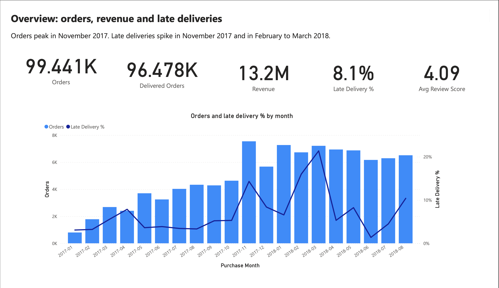
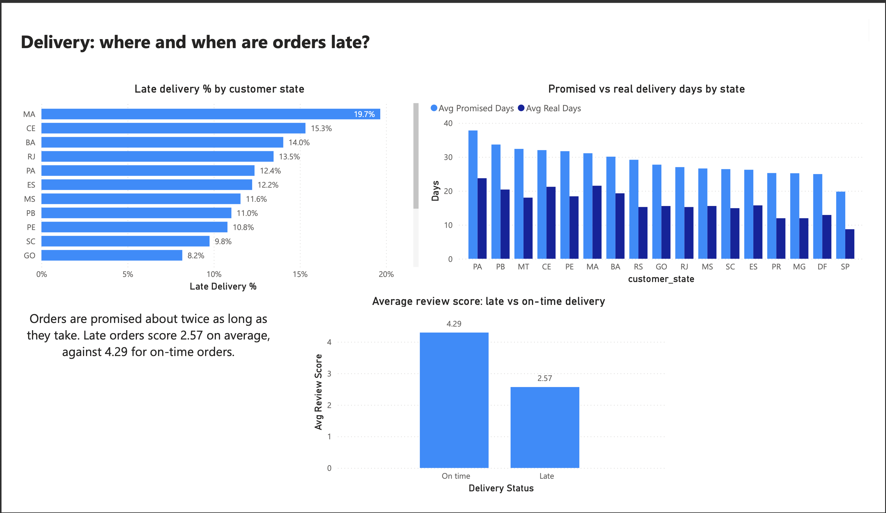
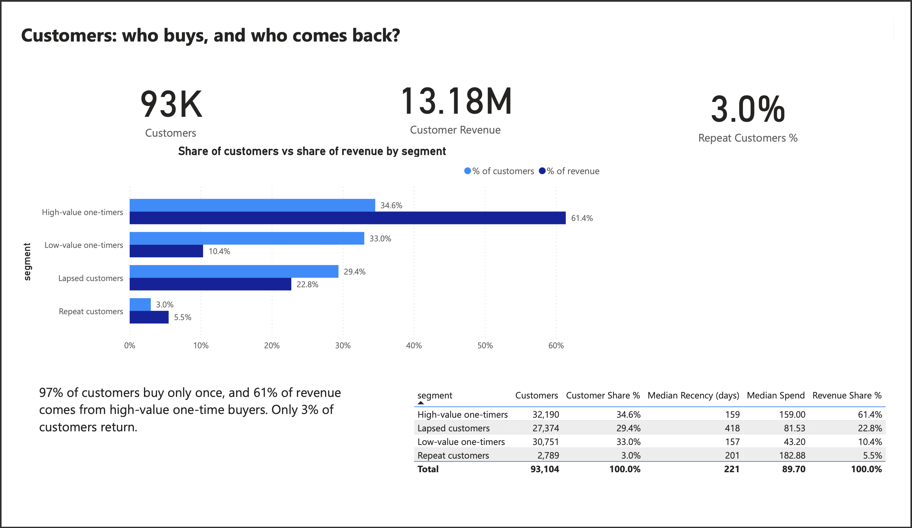
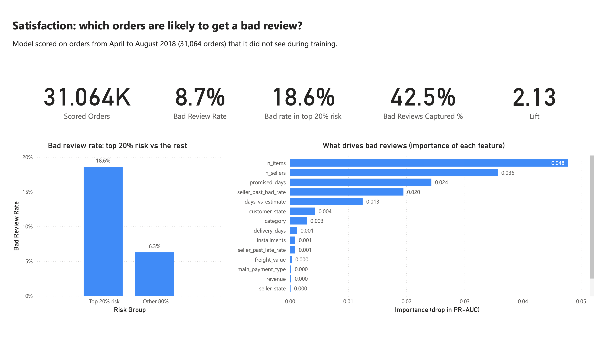

# Olist E-Commerce: Customers, Delivery and Satisfaction

An end-to-end analysis of the Olist Brazilian e-commerce dataset (about 99,000 orders, 2016 to 2018). The project covers SQL modelling in PostgreSQL, exploratory analysis, customer segmentation, a bad-review prediction model, an Excel business case, and a four-page Power BI dashboard.

Tools: PostgreSQL, Python (pandas, scikit-learn), Excel, Power BI.



## Business questions

1. Where and when are orders delivered late, and how much does it matter to customers?
2. Who are the customers, and how much of the revenue comes from repeat buyers?
3. Which orders are likely to get a bad review, and what drives that risk?

## Key findings

1. **Late delivery is rare overall but costly.** 8.1% of delivered orders arrive after the estimated date. Their average review score is 2.57, against 4.29 for orders delivered on time.
2. **Lateness depends on the state.** The highest late rates are in Maranhao (MA, 19.7%), Ceara (CE, 15.3%), Bahia (BA, 14.0%) and Rio de Janeiro (RJ, 13.5%). Sao Paulo has one of the lowest. Only states with at least 500 delivered orders are shown.
3. **Promised delivery times are longer than real ones.** In every state with enough orders, the promised time is longer than the real delivery time, so most orders arrive before the estimated date.
4. **Late deliveries spike in busy periods.** Orders peak in November 2017. The late rate rises to about 14% that month, and to about 16% in February 2018 and above 20% in March 2018, against 3% to 8% for most of 2017.
5. **Almost all customers buy once.** 97% of the 93,104 customers placed a single order, and only 3.0% (2,789) came back.
6. **Revenue sits with one-time buyers.** High-value one-time buyers are 34.6% of customers and bring 61.4% of revenue. Low-value one-time buyers are 33.0% of customers but only 10.4% of revenue. Lapsed customers (median 418 days since their last order) are 29.4% of customers and 22.8% of revenue. Repeat customers spend the most per person (median 182.88) but bring only 5.5% of revenue.
7. **Bad reviews can be ranked in advance.** On 31,064 orders from April to August 2018, which the model did not see in training, the overall bad review rate is 8.7%. The 20% of orders with the highest predicted risk have a bad review rate of 18.6%, against 6.3% for the rest. Reviewing only that top 20% would reach 42.5% of all bad reviews, a lift of 2.13 over a random 20%.
8. **The model relies on order complexity and delivery promises.** The most important features are the number of items in the order (0.048 drop in PR-AUC when shuffled), the number of sellers (0.036), the promised delivery days (0.024), the seller's past bad review rate (0.020) and the difference between real and estimated delivery (0.013). This shows what the model uses, not what causes bad reviews.

## What the data suggests

- Orders with several items or several sellers carry more bad-review risk, so they are worth checking for delivery problems early.
- Proactive contact for the top 20% risk orders could reach about 42% of the orders that would otherwise end in a bad review.
- Most revenue comes from customers who bought once. A second-purchase campaign for high-value one-time buyers and a win-back campaign for lapsed customers address the largest groups.

## Dashboard

The Power BI report has four pages.

**Overview.** Orders, delivered orders, revenue, late delivery rate and average review score, with orders and late delivery rate by month (January 2017 to August 2018).


**Delivery.** Late delivery rate by customer state, promised vs real delivery days by state, and average review score for late and on-time orders.



**Customers.** RFM segments: share of customers against share of revenue, with median recency and median spend per segment.



**Satisfaction.** The bad-review model: bad review rate in the top 20% risk group against the rest, capture rate, lift and feature importance.



## Project structure

```
olist-customer-analytics/
  data/
    processed/      files created by notebooks 02 and 03
    README.md       how to get the raw Olist files
  excel/
    delivery_business_case.xlsx
    orders_for_pivot.csv
  notebooks/
    01_eda.ipynb
    02_rfm_segmentation.ipynb
    03_bad_review_model.ipynb
  powerbi/
    screenshots/    one image per dashboard page
  sql/
    01_create_tables.sql
    02_load_data.sql
    03_data_quality.sql
    04_business_queries.sql
    05_views.sql
    DECISIONS.md
  requirements.txt
  README.md
```

The raw Olist CSV files are not stored in the repository.

## Method

**1. SQL (PostgreSQL).** Tables are created and loaded from the raw CSV files, checked for data quality, and queried for the main business metrics. Views prepare analysis-ready tables. The choices made along the way are written in `sql/DECISIONS.md`.

**2. Exploratory analysis (notebook 01).** Orders, delivery times, review scores and the relation between late delivery and review score.

**3. Customer segmentation (notebook 02).** Recency, frequency and monetary value per customer, grouped into four segments with KMeans: high-value one-timers, low-value one-timers, lapsed customers and repeat customers. Customers are identified by `customer_unique_id`, because `customer_id` changes with every order in Olist.

**4. Bad-review model (notebook 03).** A [MODEL NAME] model predicts whether an order will get a bad review ([BAD REVIEW RULE]). The data is split by time: orders up to March 2018 for training (59,536 orders) and April to August 2018 for testing (31,064 orders). Feature importance is measured as the drop in PR-AUC when a feature is shuffled.

**5. Excel business case.** `excel/delivery_business_case.xlsx`, built from `orders_for_pivot.csv`, looks at the cost of late delivery.

**6. Power BI dashboard.** Built from the raw Olist tables plus the result files from notebooks 02 and 03. The model links orders, order items, reviews, customers, products and category translations. Review scores are averaged to one row per order, because some orders have more than one review.

## Decisions and definitions

- **Late order.** A delivered order whose delivery date is after the estimated delivery date.
- **Delivery metrics use delivered orders only.** Canceled and unavailable orders have no delivery date, so they are excluded from late rates and delivery times (96,478 of 99,441 orders).
- **Revenue.** The sum of item prices on delivered orders. Freight is not included.
- **Orders, not rows.** Orders are counted by distinct order id, because an order can have several items.
- **Customers.** Counted by `customer_unique_id`.
- **State charts.** Only states with at least 500 delivered orders are shown, because small states give unreliable percentages.
- **Monthly trend.** January 2017 to August 2018 only. The months before and after have very few orders, and one late order moves the rate too much.
- **Model results.** Reported on the test period only (April to August 2018, 31,064 orders). Scoring orders the model was trained on would overstate its quality.

## Limitations

- The model scores only the test period, so the Satisfaction page does not cover all orders.
- The estimated delivery date is set by Olist, so "late" means later than that estimate, not slow in absolute terms.
- Feature importance shows what the model relies on. It does not show what causes bad reviews.
- RFM segments are based on very few repeat buyers (3% of customers), so segments mainly separate customers by value and recency.
- The data covers 2016 to 2018 and one marketplace in Brazil. The findings describe this dataset, not current conditions.

## How to reproduce

1. Download the Olist dataset from Kaggle (see `data/README.md`) and place the CSV files in `data/`.
2. Install the Python packages: `pip install -r requirements.txt`.
3. Run the SQL files in `sql/` in order (01 to 05) in PostgreSQL.
4. Run the notebooks in order: `01_eda`, `02_rfm_segmentation`, `03_bad_review_model`. Notebooks 02 and 03 write their result files to `data/processed/`.
5. Open the Power BI report and load the raw Olist tables and the files in `data/processed/`.

## Data source

Brazilian E-Commerce Public Dataset by Olist, Kaggle.

## Author

Amin Entezari, MSc Data Science, University of Milano-Bicocca
GitHub: https://github.com/aminentezari
